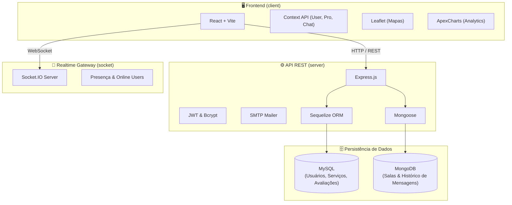

# ⚡ SideQuest V3

> **Plataforma Fullstack de Marketplace Bilateral de Serviços e Freelancers**

O **SideQuest V3** é um ecossistema completo para intermediação de serviços autônomos e contratação de profissionais. A plataforma conecta clientes com demandas pontuais a profissionais qualificados através de fluxo ponta a ponta: busca geolocalizada, propostas, chat em tempo real com Socket.IO, acompanhamento de ordens de serviço e dashboard financeiro com analytics.

---

## 🏗️ Arquitetura do Sistema

A aplicação adota arquitetura de monorepo modular dividida em três processos desacoplados:



---

## 🚀 Funcionalidades Principais

### 👤 Painel do Cliente
- **Publicação de Demandas:** Criação de solicitações de serviço com categoria, endereço e especificações.
- **Busca e Geolocalização:** Pesquisa de profissionais por região geográfica com integração do Leaflet.
- **Gestão do Ciclo do Serviço:** Acompanhamento de status (Pendente ➔ Em Andamento ➔ Concluído).
- **Avaliações & Favoritos:** Sistema de classificação por estrelas e feedback pós-atendimento.

### 👷 Painel do Profissional
- **Feed de Oportunidades:** Visualização de solicitações abertas filtradas por categoria profissional.
- **Candidatura e Aceite:** Envio de orçamentos e aceitação de propostas.
- **Dashboard com Analytics:** Gráficos interativos (ApexCharts) de faturamento, volume de propostas e taxa de conclusão.
- **Perfil & Portfólio:** Customização de biografia, formações, histórico e crop de fotos server-side.

### 💬 Comunicação Real-Time
- Gateway Socket.IO dedicado para mensagens instantâneas.
- Indicador de status online/offline em tempo real.
- Notificações de novas mensagens e atualizações de propostas.

---

## 🛠️ Stack Tecnológica

| Camada | Tecnologias |
|---|---|
| **Frontend** | React 18, Vite, React Router DOM, Axios, ApexCharts, Leaflet, Swiper, Image-JS |
| **Backend REST** | Node.js, Express, Sequelize ORM, Mongoose, JWT, Bcrypt, Nodemailer |
| **WebSocket** | Socket.IO |
| **Bancos de Dados** | **MySQL** (dados estruturados e relacionais) + **MongoDB** (mensagens e chat) |
| **Estilização** | CSS Modules, Flexbox/Grid, Componentes reutilizáveis |

---

## 📂 Estrutura do Repositório

```text
SideQuestV3/
├── client/                 # Frontend React + Vite
│   ├── src/
│   │   ├── components/     # 26 componentes modulares (Charts, Navbar, Cards)
│   │   ├── context/        # Estado global (UserContext, ProfissionalContext, ChatContext)
│   │   ├── hooks/          # Custom hooks utilitários
│   │   ├── pages/          # 25 views (Dashboards, Chats, Autenticação, Feed)
│   │   └── Router.jsx      # Definição de rotas SPA
│   ├── package.json
│   └── vite.config.js
│
├── server/                 # API REST Express + Sequelize/Mongoose
│   ├── config/             # Configurações de Express, DB, SMTP
│   ├── database/           # Conexões MySQL/MongoDB e seeds geográficos
│   ├── routes/             # Rotas de usuários, profissionais, chats e mensagens
│   ├── src/
│   │   ├── controllers/    # Controladores com regras de negócio
│   │   └── models/         # 16 modelos relacionais (Sequelize)
│   ├── tools/              # Helpers de autenticação e tokens JWT
│   ├── .env.example        # Modelo de variáveis de ambiente
│   ├── server.js           # Ponto de entrada da API
│   └── package.json
│
├── socket/                 # Gateway WebSocket Standalone
│   ├── index.js            # Servidor Socket.IO com gerenciamento de sessões
│   └── package.json
│
└── README.md
```

---

## ⚙️ Como Executar Localmente

### Pré-requisitos
- [Node.js](https://nodejs.org/) (v16 ou superior)
- [Yarn](https://yarnpkg.com/) ou [NPM](https://www.npmjs.com/)
- [MySQL Server](https://www.mysql.com/) rodando localmente na porta `3306`
- [MongoDB](https://www.mongodb.com/) rodando na porta `27017`

---

### 1. Configurar e Iniciar o Backend (`server`)

```bash
cd server
yarn install

# Configure as variáveis de ambiente
cp .env.example .env

# Inicie o servidor Express
yarn start
```
> O servidor iniciará na porta **5000**.

---

### 2. Iniciar o Gateway WebSocket (`socket`)

```bash
cd ../socket
yarn install
yarn start
```
> O serviço de WebSocket escutará conexões na porta padrão configurada.

---

### 3. Iniciar o Frontend (`client`)

```bash
cd ../client
yarn install
yarn dev
```
> A aplicação Web estará acessível em `http://localhost:5173`.

---

## 🔒 Variáveis de Ambiente (`server/.env`)

| Variável | Descrição | Exemplo |
|---|---|---|
| `PORT` | Porta HTTP da API Express | `5000` |
| `DB_HOST` | Host do banco MySQL | `localhost` |
| `DB_PORT` | Porta do MySQL | `3306` |
| `DB_NAME` | Nome do banco de dados relacional | `db_sidequest` |
| `DB_USER` | Usuário do MySQL | `root` |
| `DB_PASSWORD` | Senha do MySQL | `root` |
| `MONGO_URI` | String de conexão MongoDB | `mongodb://0.0.0.0:27017/db_chats_sidequest` |
| `JWT_SECRET` | Chave secreta de assinatura JWT | `seu_segredo_super_seguro` |
| `SMTP_HOST` | Host do servidor de e-mail | `smtp.office365.com` |
| `SMTP_USER` | Conta de disparo de e-mails | `Sidequest.plataform@outlook.com` |

---

## 📄 Licença

Este projeto está sob a licença [MIT](LICENSE).
